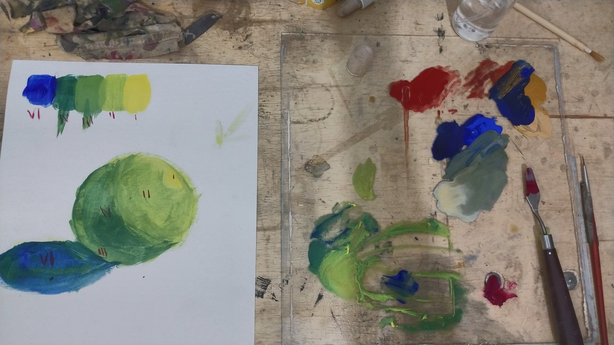
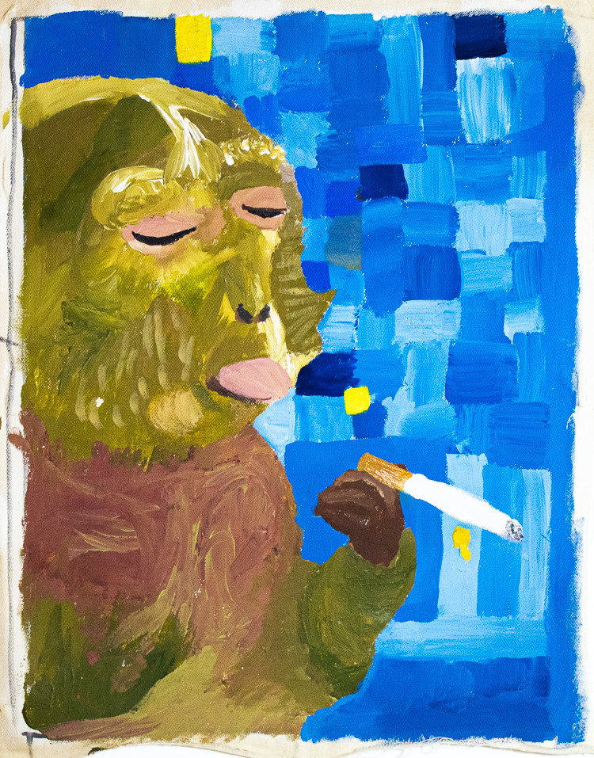
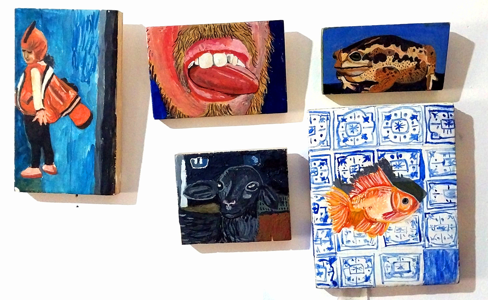

## Eu quero que você consiga olhar para a sua própria pintura e pensar:

  <blockquote>
    "Eu consigo fazer esse negócio. Eu sei o que estou fazendo."
  </blockquote>

Não porque saiu perfeito. Não porque alguém disse que ficou bom.

Mas porque você entende o que está fazendo, sabe por que tomou cada decisão e sente que tem controle suficiente sobre o processo.

Talvez você queira construir uma prática artística e se aproximar do circuito das artes. Talvez trabalhe em uma área completamente diferente e esteja procurando uma atividade criativa que faça sentido na sua rotina. Talvez já pinte e queira melhorar seu olhar e entender suas decisões. Talvez queira retomar uma prática que ficou parada.

Para que essa **sensação de domínio** deixe de ser uma exceção e passe a fazer parte da sua prática, existe a Formação em Pintura Acrílica.

  <a href="#oficina-offer-formacao">Quero entrar na turma fundadora →</a>

## Como a formação funciona

A formação dura oito semanas e alterna dois tipos de aula: em uma semana, você acompanha uma aula de pintura guiada; na seguinte, realiza um exercício de pintura livre para colocar em prática o que aprendeu.

As aulas têm duas horas de duração e ficam disponíveis assim que são gravadas. Nessa turma, as gravações acontecem ao longo das semanas que antecedem o início da formação: então quando as aulas começarem, o material já estará disponível para você assistir quando quiser.

Essa alternância cria um ciclo claro: primeiro você vê os conceitos sendo aplicados, depois experimenta por conta própria, e por fim recebe uma devolutiva sobre seu trabalho. É esse ciclo que te coloca no caminho da autonomia real.

  

    01
    <h3>Aula guiada</h3>
    
Você acompanha uma aula gravada no formato "pinte comigo". Enquanto pinto, explico cada decisão e o motivo por trás dela. O objetivo é entender o processo, não apenas reproduzir o resultado.

  

  

    02.a
    <h3>Exercício livre</h3>
    
Você recebe uma imagem para pintar aplicando o que aprendeu. O objetivo é fazer você tomar suas próprias decisões e começar a  construir autonomia na pintura.

  

  

    02.b
    <h3>Encontro coletivo</h3>
    
Temos um encontro coletivo semanal pelo Meet para devolutivas e tira-dúvidas. É um espaço para analisar os exercícios, discutir as escolhas de cada aluno e esclarecer dúvidas sobre o processo de pintura.

  

  

    03
    <h3>Devolutiva individual</h3>
    
Semanalmente você me manda uma foto do que pintou pelo WhatsApp, com suas dúvidas. Eu respondo por áudio, olhando especificamente para o seu trabalho: o que vejo, por que funciona ou não, e o que é técnica versus o que é gosto.

  

A cada duas semanas você vai perceber que precisa cada vez menos de uma receita para pintar. Começamos com exercícios mais simples e aumentamos a complexidade aos poucos. Na última pintura, não haverá tema imposto nem critério rígido: você vai escolher o que quer pintar e decidir como quer fazer.

  <a href="#oficina-offer-formacao">Quero entrar na turma fundadora →</a>

---

## Os quatro módulos

Cada módulo dura duas semanas e se concentra em um fundamento da pintura. Vamos começar pelas questões mais básicas e, a cada módulo, ampliar as possibilidades que você tem para fazer escolhas.

Mais do que aprender técnicas isoladas, a ideia é entender como essas escolhas funcionam juntas e começar a desenvolver critérios para avaliar o que está acontecendo na sua própria pintura.

---

## Para quem é

Essa formação foi pensada para quem quer construir uma prática consistente de pintura, independentemente do ponto em que está.

O único pré-requisito é ter vontade de pintar e disposição para praticar durante oito semanas.

---

## Para quem não é

Essa formação provavelmente não é para você se o que procura é uma receita pronta para reproduzir pinturas sem entender o que está fazendo. Também não é para quem espera uma solução rápida, sem prática ou sem dedicação entre uma aula e outra.

Meu objetivo não é que você aprenda a pintar exatamente como eu. É que, aos poucos, você consiga tomar suas próprias decisões e construir uma prática que faça sentido para você.

---

## O que você leva ao final das oito semanas

Você terá produzido algumas pinturas e, mais importante, terá desenvolvido ferramentas para continuar pintando depois que a formação terminar.

Vai saber observar uma pintura com mais atenção, entender melhor as consequências das suas escolhas, avaliar o próprio trabalho com mais clareza e tomar decisões com muito mais autonomia. Vai ter ampliado seu repertório e construído uma prática mais consistente sem depender de copiar o que outra pessoa faz.

  <a href="#oficina-offer-formacao">Quero entrar na turma fundadora →</a>

---

## Sobre os materiais

Você não precisa de um estúdio caro nem de dezenas de tubos de tinta para começar.

Assim que confirmar sua vaga, você recebe uma lista com os materiais necessários — todos simples e fáceis de encontrar. Se você já tiver parte deles, pode aproveitar o que tem.

---

## Turma fundadora

Nas próximas turmas, o material gravado já vai estar pronto. Essa turma é diferente

As quatro aulas gravadas ainda não existem. Elas vão ser feitas ao vivo entre 15 de setembro e 5 de outubro, com quem já confirmou a vaga. Quem entra agora vai estar presente no momento em que cada aula é construída: pode interagir, fazer perguntas, influenciar o que entra no material permanente.

Quando a formação começar em 6 de outubro, você já vai ter o material todo disponível e vai ter mais tempo pra se dedicar aos exercícios livres.

A primeira gravação é dia 15 de setembro. Quem entra depois perde.

Além disso, o valor não vai ser de R$800,00, mas de R$400,00: metade do que vai custar nas próximas turmas.